# Bugs found — Joy Dice (QA assessment build)

Environment: https://qa-assessment-dice.play.purejoy.games/ · game iframe `dev-games.cbet.cf.cvl.joystudios.xyz/cbet-dice` · Fun Mode, USD · Cypress 13.17 headless Electron 118, also reproduced by hand in a Chromium browser · Windows · 2026-11-23.

**Status at the final recorded runs (2026-11-24):** 7 bugs are open. **BUG-001 is fixed**: it was caught by the suite, then confirmed fixed by the same tests after a redeploy around 2026-11-24 00:50 (details in its section).

BUG-002 to BUG-006 each have a test that asserts the **correct** behaviour and fails today; those tests are marked with `knownBug('BUG-xxx')` (see `cypress/support/knownBug.ts`). BUG-001's three tests used to be marked the same way. Now that it's fixed they're plain regression tests, and they pass. BUG-007 and BUG-008 were found by exploratory testing and aren't in the regression suite yet (see the [exploratory testing](#exploratory-testing) section). Both were rechecked on the new build and still reproduce.

**Screenshots.** Every bug has annotated screenshots, with red boxes and numbered labels on the evidence. They're generated, not hand-edited: `npm run screenshots:bugs` runs [`cypress/evidence/bug-evidence.cy.ts`](cypress/evidence/bug-evidence.cy.ts), which reproduces each bug, asserts the buggy state, draws the annotations and saves the image to [`docs/screenshots/`](docs/screenshots). It covers BUG-007 and BUG-008 too, so it passes only while the bugs still reproduce. If it starts failing, a bug has probably been fixed. BUG-001's tests in it are now skipped and labelled "historical"; their screenshots are kept as evidence of the old behaviour.

| ID | Severity | Summary | Test |
|----|----------|---------|------|
| BUG-001 | ~~Critical~~ **✅ Fixed** in the build deployed around 2026-11-24 00:50 | After a roll of exactly 50.00 (Seed B) the client never applied the settlement: the balance was wrong, the game locked, and in Auto mode bets continued unseen | `01-seeded-results` › Seed B (now passing regression tests) |
| BUG-002 | Medium | "Profits on Win" shows the payout, not the profit (overstated by the stake) | `03-bet-balance` › displayed profit |
| BUG-003 | Medium | Some typed targets are stored 0.01 lower than typed (≈5.8% of values) | `02-recalculation` › known defects |
| BUG-004 | Low | Multiplier slightly under the rule at some targets (Under 4.38 → ×22.604, should be ×22.605) | `02-recalculation` › known defects |
| BUG-005 | Low | Win chance shows the nominal range, not the real chance out of 10,001 rolls | `02-recalculation` › known defects |
| BUG-006 | Low | A bet typed with 5+ decimals is silently replaced by the 0.01 minimum | `03-bet-balance` › bet amount controls |
| BUG-007 | Medium | A bet whose payout would exceed the $1,000,000 max win is silently ignored: no message, Bet looks enabled | exploratory (screenshot spec) |
| BUG-008 | Low | With hotkeys turned on, the Space hotkey ignores the in-flight lock: two taps place two bets, two clicks place one | exploratory (screenshot spec) |

---

## BUG-001 — After a roll of exactly 50.00 the client never applies the settlement

> **✅ Status: Fixed in the build deployed around 2026-11-24 00:50.** Everything below this note is the original report, kept as historical evidence.
>
> **How the fix was found.** Every full run before about 00:50 failed the three Seed B tests (about ten runs over the evening). The next run, which started at 00:52, passed them without any change to the suite, as has every run since. A manual retest in a visible browser confirmed it:
>
> | Seed B, roll 1 = 50.00 | Result | Balance |
> |---|---|---|
> | Roll Over 50.00 | Loss | 2,985.0000 ✅ |
> | Roll Under 50.00 | Loss | 2,985.0000 ✅ |
> | Roll Over 40.00 | Win, paid 24.7515 | 3,009.7515 ✅ |
>
> In each case the round is now recorded in Previous Results, the dice shows 50.00, and Bet re-enables. The three Seed B tests had their `knownBug('BUG-001')` markers removed and now run as normal regression tests, so the suite will catch it if it comes back. The final three recorded runs all pass them.
>
> Retest evidence, from [`cypress/evidence/bug-evidence-retest.cy.ts`](cypress/evidence/bug-evidence-retest.cy.ts):
>
> 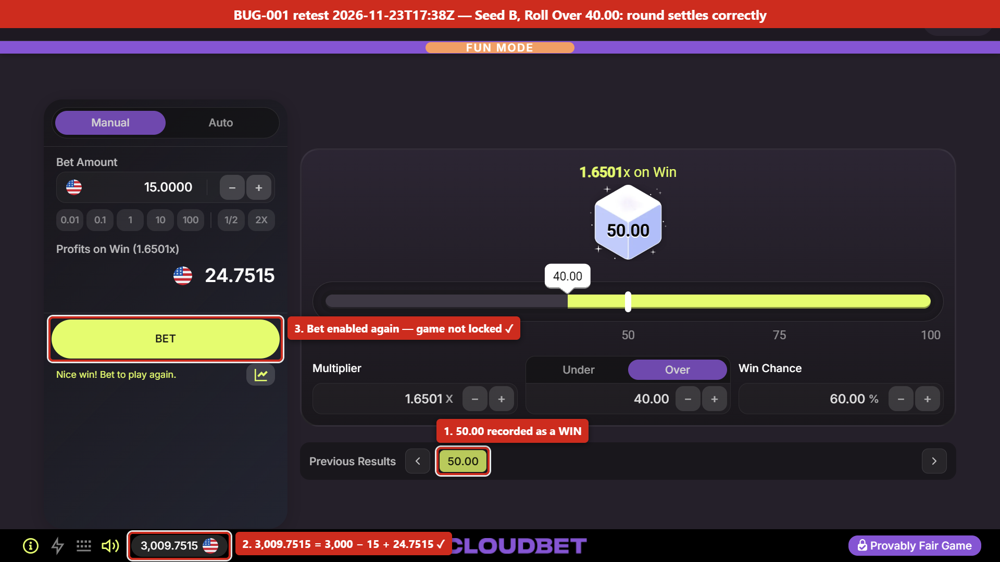
>
> Also: [Roll Over 50.00](docs/screenshots/BUG-001-retest-over-50.png) · [Roll Under 50.00](docs/screenshots/BUG-001-retest-under-50.png)
>
> I didn't verify the Auto-mode part of this bug after the fix.

**Severity (when open):** Critical. The balance shown was wrong and the game locked. In Auto mode, real bets kept being placed while the screen showed nothing.

**Steps**
1. Open the launcher, pick Joy Dice, choose **Seed B**, press Play.
2. Leave the preset Roll Over 50.00 (or set Roll Under 50.00, or Roll Over 40.00) and bet 15.
3. Wait as long as you like (checked for up to 15 s, the result never changed).

**Expected**
- The round settles. At Over 50.00 and Under 50.00 the roll 50.00 loses (it's neither greater nor less than the target), so the balance is 2,985.0000.
- At Over 40.00 the roll 50.00 wins: the balance is 3,000 − 15 + 15 × 1.6501 = 3,009.7515.
- The roll appears in Previous Results and Bet becomes enabled again.

**Actual**
- The roll value 50.00 and the win/loss message appear. At Over 40.00 the message is "Nice win! Bet to play again."
- The balance only ever drops by the stake (2,985.0000), **including when the message says the bet won**. The winnings are never credited.
- Previous Results stays empty and every control stays disabled (Bet, target, bet amount, Manual/Auto). The only way out is to reload, which creates a new player.
- Seed A rounds settle normally in about 1.4 s, so this is specific to this roll (or this seed), not a slow network.

**Root cause narrowed down (exploratory testing): the server settles correctly; the client doesn't.**
- The in-game **Provably Fair › Bet History** for the frozen Over 40.00 round shows *bet 15.0000, cash out 24.7515, 1.65x* (round `ARD:CBT:DEV:968100835480`). The server paid the win.
- Reloading **only the game iframe** (same session, no new visit) shows the correct balance, **3,009.7515**, and unlocks the game. The next bet gets roll 2 = 64.28, as the seed predicts.
- So the server's wallet is right, and the client fails to process the 50.00 round's result. Previous Results is also empty after the reload.
- 50.00 is a genuine provably-fair result for Seed B, not a value injected for the test. Using Cloudbet's published algorithm (see the exploratory testing section), Seed B's rolls are 50.00, 64.28, 93.33, 42.89. A Seed B player can never reach roll 2 without reloading.
- The freeze happens with Over 50.00 (loss), Under 50.00 (loss) and Over 40.00 (win). It's triggered by the roll value, not by a tie.

**Worse in Auto mode.**
1. Seed B, Auto, Over 98.00, Number of Bets 6, On Loss +100%, Start Auto Bet.
2. **Actual:** the screen freezes at "1 / 6 Auto Play" and still shows 3,000.0000 with an empty Previous Results.
   - Bet History shows the server placed **two** bets: 15.00 on 50.00 and 30.00 on 64.28, both lost.
   - The bet field has already doubled to 30.0000.
3. Stop Auto Bet changes the message to "Start Auto Bet", but Stop stays visible and Start stays disabled.
4. Only reloading the iframe shows the real balance: **2,955.0000**. Before that, the screen overstated the balance by 45.

**Screenshots**

*The frozen round:* a win is shown and the stake was taken, but there's no payout, no history entry, and every control is locked.

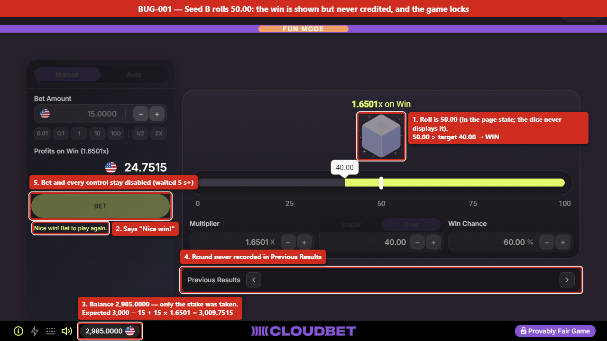

*The server's own record (Provably Fair › Bet History) shows the round was settled and paid:*

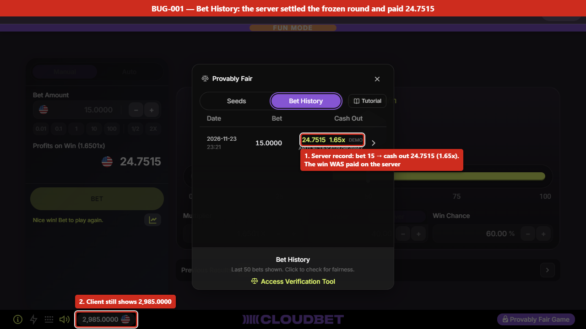

*Reloading only the game iframe (same session) shows the correct balance:*

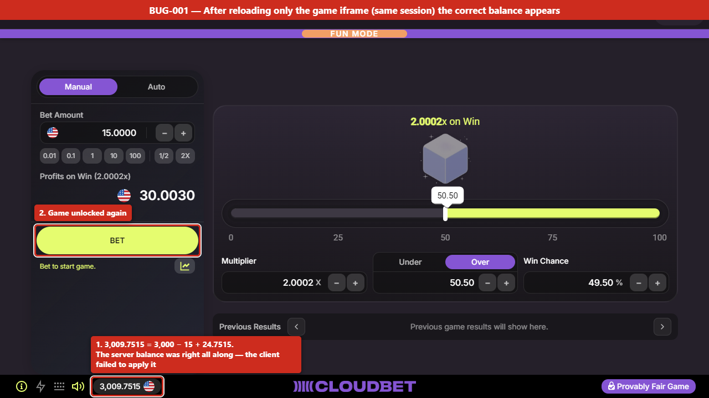

*Auto mode: frozen at "1 / 6", still showing 3,000, while the server places bets:*

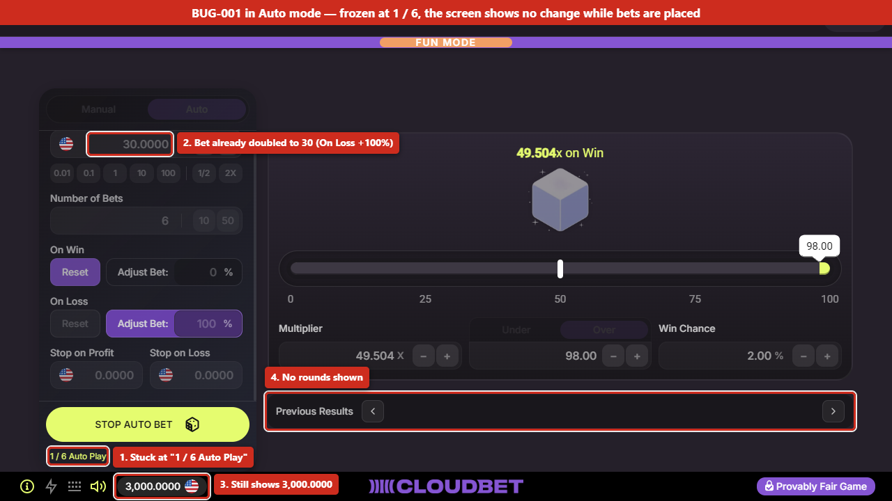

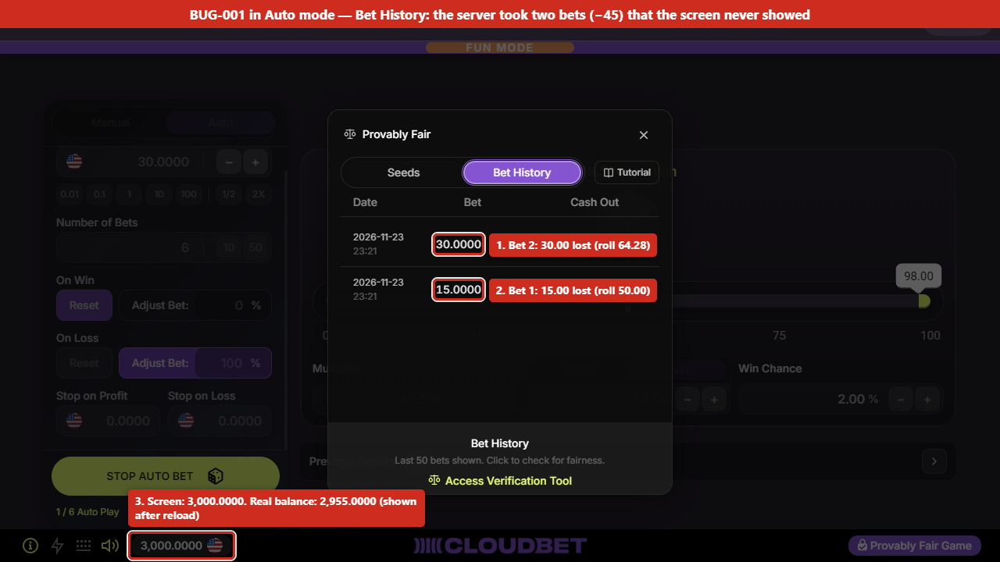

**Impact:** the balance shown is wrong, in both directions. A winning bet is shown as won but not credited on screen, and in Auto mode real losses happen without being shown. The session is unusable until reload. In real-money mode this would cause disputes ("I won but wasn't paid", "my balance dropped by itself").

**Suggested investigation:** start with the client's round-result handling for this specific result. The browser console showed nothing apart from third-party telemetry 429s, so check whether the result message is received and why the round never transitions to "finished".

---

## BUG-002 — "Profits on Win" shows the payout, not the profit

**Severity:** Medium (misleading money display; a regulatory risk in real-money mode)

**Steps:** Seed A · Roll Over 98.00 (×49.504) · bet 15.

**Expected:** Profit on win = 15 × 49.504 − 15 = **727.5600**. This matches the real balance change: 3,000.0000 → 3,727.5600 after a win.

**Actual:** The label reads "Profits on Win (49.504x) **742.5600**", which is the total payout. The same holds at every bet and multiplier tried: the figure is always bet × multiplier.

**Impact:** every winning bet's profit is overstated by exactly the stake.

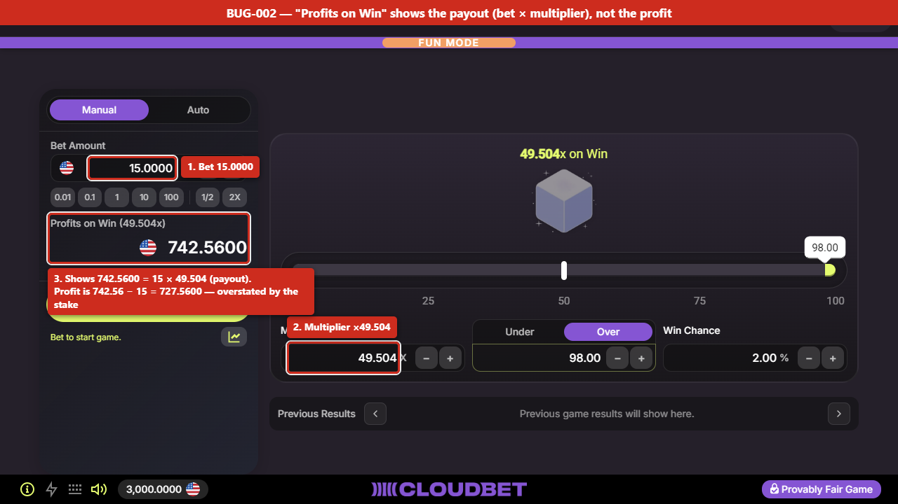

---

## BUG-003 — Some typed targets are stored 0.01 lower than what was typed

**Severity:** Medium (the odds shown and used aren't the ones the player chose)

**Steps:** Roll Over, type `16.49` in the target field and tab out. Or Roll Under, type `1.16`.

**Expected:** Target 16.49 → ×1.1856, win chance 83.51%.

**Actual:** The target becomes **16.48** (×1.1854, 83.52%). Under 1.16 becomes **1.15**.

**Scope:** an 854-value sweep across both directions found 46 such values, for example 16.49, 18.33, 20.40, 33.05, 64.10 and 81.35 (Over), and 1.16, 8.29, 17.49, 39.80 and 80.74 (Under). Every one matches `Math.floor(x * 100) / 100` on a binary float (16.49 × 100 = 1648.9999…). Run over every possible target, that predicts 566 of 9,800 Over values and 573 of 9,800 Under values are affected. The −/+ buttons and back-solving don't seem affected.

**Suggested fix:** parse the input as an integer number of hundredths (`Math.round(x * 100)`), or round instead of flooring.

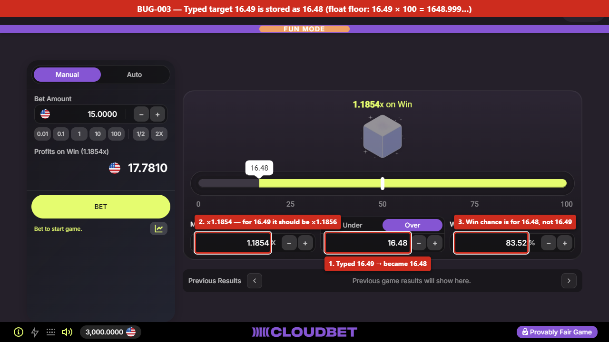

---

## BUG-004 — Multiplier is slightly below the rule at some targets

**Severity:** Low (a small underpayment; RTP below the advertised 99% at those targets)

**Steps:** Roll Under, target `4.38`.

**Expected:** There are 438 winning rolls out of 10,001. 0.99 × 10,001 / 438 = 9,900.99 / 438 = **22.605 exactly**, so the 5-significant-digit cut is ×22.605.

**Actual:** ×**22.604**. A 15 bet would be paid 339.06 instead of 339.075.

**Notes:** this was the only multiplier mismatch in the 854-value sweep that BUG-003 doesn't explain. The likely cause is floating-point error before the truncation (22.60499… cut to 22.604). Exact integer or decimal maths before truncating would fix it.

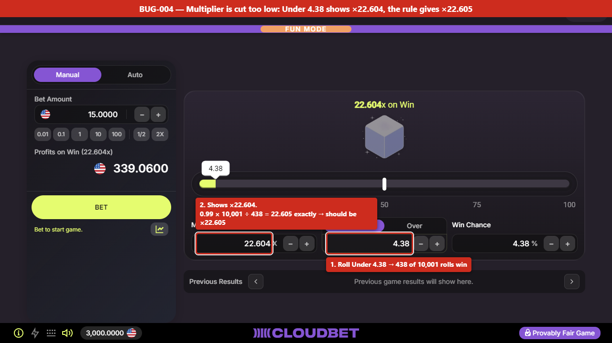

---

## BUG-005 — Win chance shows the nominal range, not the real chance out of 10,001 rolls

**Severity:** Low (a display issue, but it disagrees with the multiplier shown)

**Steps:** Roll Over, target `2.00`.

**Expected:** 9,800 winning rolls / 10,001 = 97.99%. That's the probability the multiplier is based on (0.99 / 0.97990 = ×1.0103, which the game shows correctly).

**Actual:** **98.00%**, which is just 100 − target. Under shows the target itself. In the sweep, 395 of 854 values showed the nominal figure rather than the exact one. Over every possible target, 4,999 of 9,800 would differ at 2 decimals.

**Impact:** the win chance shown is higher than the real one, and win chance × multiplier doesn't equal 99%.

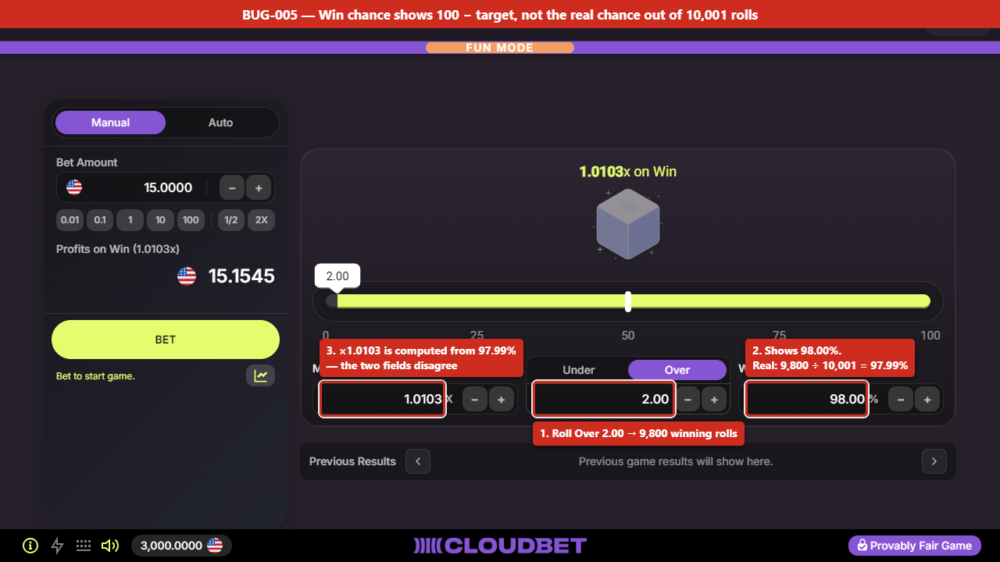

---

## BUG-006 — A bet typed with 5 or more decimals silently becomes 0.01

**Severity:** Low (a surprising stake change with no message)

**Steps:** type `1.23456` (or `12.34567`, `2.99999`) in Bet Amount and tab out.

**Expected:** truncate or round to 4 decimals (1.2345 / 1.2346), or reject the input with a validation message.

**Actual:** the field silently changes to **0.0100**, the minimum bet, with `aria-invalid="false"` and no message. Up to 4 decimals works (12.3456 is kept).

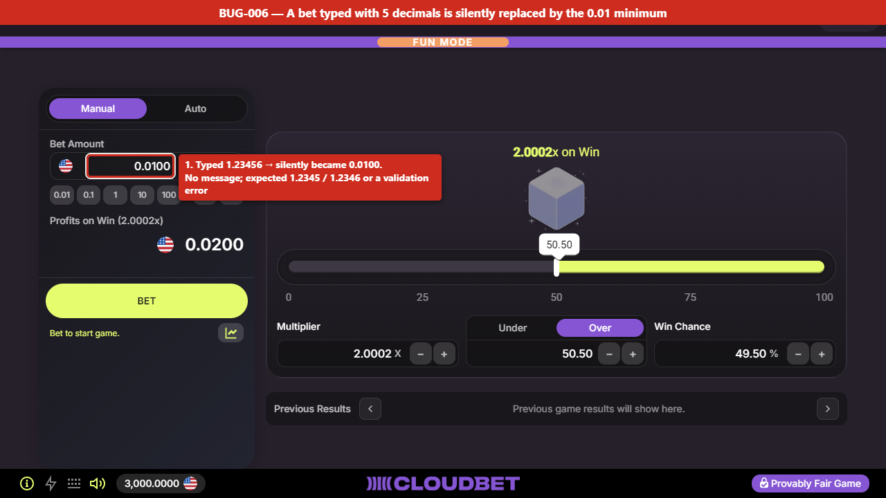

---

## BUG-007 — A bet whose payout would exceed the $1,000,000 max win is silently ignored

**Severity:** Medium (the player can't tell why nothing happens; it looks like a frozen game)

Game Information says: *"Max Win for One Bet (USD) $1,000,000"*.

**Steps** (Seed A, so the rolls are known)
1. Roll Over 98.00, bet 3000, Bet. Roll 1 = 98.29 wins; the balance becomes 148,512.0000.
2. Roll Over 98.50 (×66.006), type a bet of **15151** (payout 1,000,056.91). The label reads "Profits on Win (66.006x) 1,000,056.9060". Click Bet.

**Expected:** the cap is enforced *with feedback*. For example: disable Bet with a message like "Max win is $1,000,000", lower the bet to the largest allowed (15,150.07), or show an error after the click.

**Actual:** nothing happens. There's no roll, no message, no change to the balance or nonce, and Bet still looks enabled. The status line keeps showing the previous round's "Nice win! Bet to play again."

**Boundary confirmed:** a bet of 15,150.08 (payout 999,996.18) is accepted, wins roll 2 and settles correctly (balance 1,133,358.1004). So the cap itself works: it applies to the payout (bet × multiplier), not the profit. Only the feedback is missing. The same happens with any large bet at a high multiplier, for example Under 0.01 (×9900.9) with any bet above 101.

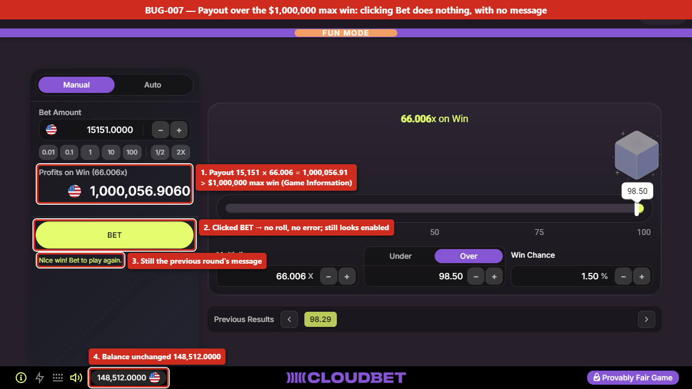

---

## BUG-008 — The Space hotkey ignores the "round in progress" lock

**Severity:** Low. A double-tap places bets the player didn't mean to, but only for players who turn hotkeys on.

> **Correction:** an earlier version of this report said hotkeys are on by default. They aren't. On a fresh browser profile hotkeys are **off**, and Space does nothing. The first click on the footer's Hotkeys button turns them on ("Hotkeys Enabled"), and the choice is saved in `localStorage` (`joy-hotkeys:joy-dice=true`), so it stays on for every later visit. My manual session had turned them on earlier, which is why they looked on by default. I found this while automating the screenshot below, which starts from a clean profile.

**Steps:** Seed A, defaults (bet 15). Click the **Hotkeys** button in the footer (the panel shows "Hotkeys Enabled"). Click an empty area of the game, then press **Space twice, 120 ms apart** (a normal double-tap).

**Expected:** one bet, the same as the Bet button. While a round is in flight (about 1.4 s), the button ignores further clicks.

**Actual:** **two bets** are placed (rolls 98.29 and 98.51, balance 3,030.0060). Tested at each spacing on a fresh player:

| Input | 2 presses, 120 ms apart | 2 presses, 250 ms apart | 5 presses, 40 ms apart |
|---|---|---|---|
| Mouse on Bet | 1 bet | 1 bet | — |
| Space hotkey | **2 bets** | **2 bets** | **5 bets** (75 staked in about 0.2 s) |

Every bet was debited and settled correctly, so the money isn't miscalculated. The player just places bets they didn't mean to. Holding Space down (key-repeat) didn't add extra bets, so repeat events are filtered. Typing in the bet field doesn't trigger hotkeys.

**Suggested fix:** share the button's in-flight lock with the hotkey handler.

The screenshot was reproduced from a clean profile with **real** (trusted) input. Cypress sent an OS-level mouse click and two Space key presses through the Chrome DevTools Protocol, because the game ignores synthetic `KeyboardEvent`s:

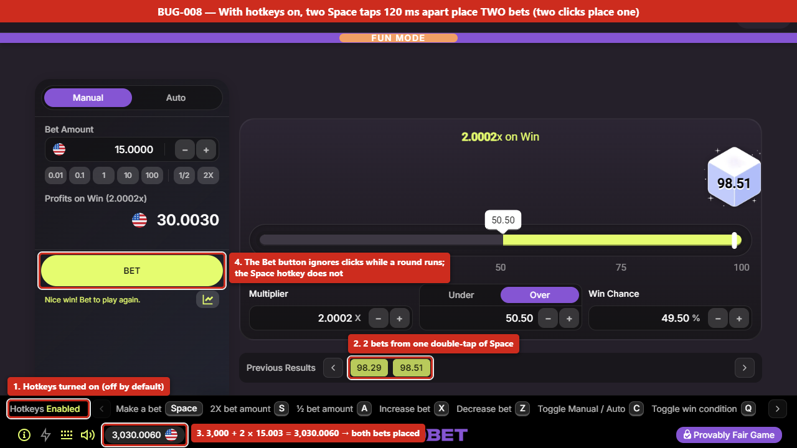

---

## Exploratory testing

A session-based exploratory pass after the suite was built (charter: *"what else could cost a player money or trust?"*). Areas covered and what was found:

| Area | What I did | Result |
|---|---|---|
| **Provably fair** | Took the launcher's Seed A and Seed B server and client seeds and ran Cloudbet's published Dice verifier (SHA3-256 round signature → SHAKE256 → 32-bit rejection sampling → mod 10,001). Compared it with the in-game commitment and rolls. | ✅ `SHA3-256(server seed)` equals the commitment shown in the game for both seeds. Seed A nonces 1–6 reproduce **98.29, 98.51, 12.59, 4.90, 33.35, 28.13** exactly. Seed B gives **50.00, 64.28, 93.33, 42.89**, and 64.28 was then seen in the game (after reloading past BUG-001). |
| **Frozen-round recovery** | Bet History and seed nonce during BUG-001; reloading only the iframe. | 🐞 Server settles, client doesn't (BUG-001, updated). Reloading the iframe recovers the session and the correct balance. |
| **Max win cap** | Built a balance above $1M from Seed A's known wins and probed the cap at bets either side of it. | 🐞 The cap is enforced silently (BUG-007). The cap value is correct. |
| **Auto bet** | 6 bets, On Loss +100%, on Seed B. | 🐞 Bets continue server-side while the client is frozen (folded into BUG-001). Auto with Seed A wasn't completed in the time available. |
| **Hotkeys** | The Hotkeys panel (off by default; the first click turns them on and it's remembered: Space bet, S 2x, A ½, X/Z bet ±, C mode, Q direction, W/E target). Space vs mouse at 40, 120 and 250 ms; key-repeat; keys while typing in the bet field. | 🐞 BUG-008. Key-repeat and typing in a field are handled correctly. |
| **Game information** | Read the rules panel. | Says RTP 99%, minimum bet $0.01, max win $1,000,000, and "Win up to 9900.9x" (matches Under 0.01 / Over 99.99). |

Not covered (time): sound and lightning toggles, mobile viewport, slow or failed network between bet and result, and two tabs on one session. These are next on the list (see the README wrap-up).

---

## Notes (observed, not filed as bugs)

- **N-1 — The Bet button's guard depends on re-rendering.** Click events fired within a single JavaScript task each start a bet. `button.click()` called 5 times in a row placed 5 bets, and Cypress's `dblclick()` placed 2. Each one was debited and settled correctly. A real double-click (OS-level mouse events, 0 ms and 80 ms apart) and two native clicks 50 ms apart place exactly **one** bet, so this can't be reproduced with a mouse and isn't filed as a bug. It's closely related to BUG-008, which *is* reachable by a real user via the Space hotkey. A single in-flight flag checked by every bet entry point would fix both.
- **N-4 — The launcher remembers the last seed selected.** After choosing Seed B once, the next visit's "Pick a deal" dialog opens with Seed B already selected. It's still a new player with a fresh balance. That's fine for a demo, but a tester (or an automated test) that assumes "Seed A is the default" will silently play the wrong seed. The suite always selects the seed explicitly.
- **N-5 — After reloading the iframe, the bet amount isn't the default of 15.** After recovering from the Auto-mode freeze, the bet field showed 10.0000, neither the default 15 nor the doubled 30 the Auto run had set. The cause is unclear; noted, not filed.
- **N-6 — Payouts with more than 4 decimals are truncated.** Bet 15,150.08 × 66.006 = 999,996.18048 was credited as 999,996.1804. The player loses 0.00008. It's well under display precision; noted for completeness.
- **N-2 — Third-party noise.** The launcher's CSP blocks the Cloudflare Insights beacon. Telemetry posts (`non-prod-watson…/api/v1/events`, Sentry) are aborted or return 429. None of this affects the game; the suite stubs these hosts.
- **N-3 — Behaviour confirmed as correct:**
  - Target clamping: Over 2.00–99.99, Under 0.01–98.00.
  - Bet clamping: above the balance lowers it to the balance; 0, negative and below 0.01 raise it to 0.01.
  - Bet is disabled with "Bet exceeds your balance" or "Insufficient balance" when the stake isn't covered.
  - The balance reaches exactly 0.0000 on an all-in loss.
  - Every new visit is a new player with 3,000 and the seed restarts from roll 1.
